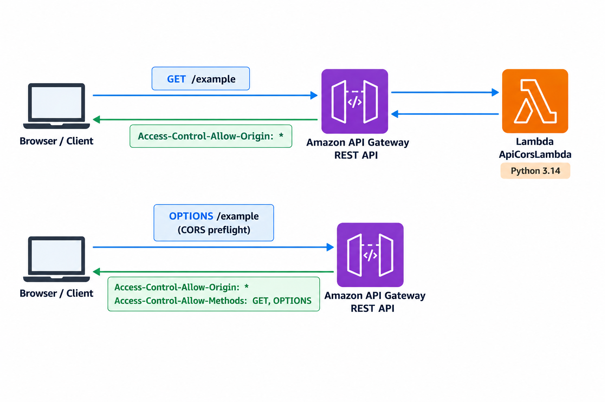

# API Gateway + CORS + Lambda

This AWS CDK example creates an Amazon API Gateway REST API integrated with an
AWS Lambda function. The API exposes a CORS-enabled `GET /example` endpoint.

## Request flow

- `GET /example` invokes the Lambda function through a non-proxy integration.
  The function returns HTTP `200` with the body
  `Lambda was invoked successfully.` The API response includes
  `Access-Control-Allow-Origin: *`.
- `OPTIONS /example` handles browser CORS preflight requests directly in API
  Gateway; it does not invoke Lambda. It returns HTTP `204` and allows any
  origin and the `GET` and `OPTIONS` methods.

The Lambda function uses the Python 3.14 runtime. The API methods do not
configure authorization.
